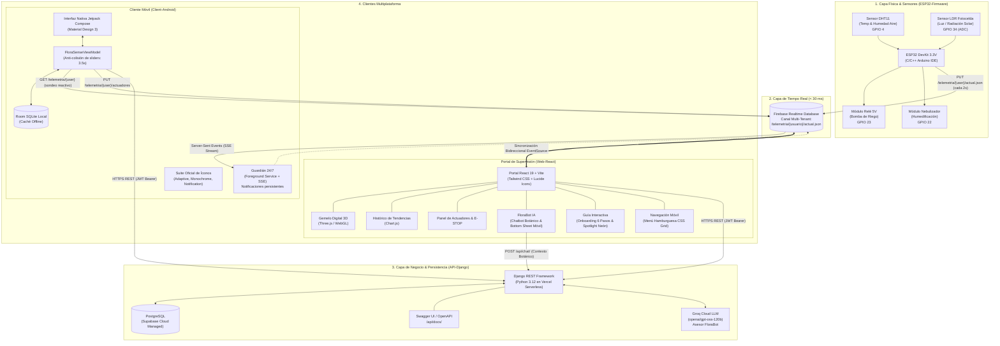

# SmartGarden — Documento de Contexto Maestro del Ecosistema

> **Documento de Referencia Integral**  
> **Versión:** 2.0 (Producción & Evaluación Académica)  
> **Última Actualización:** 17 de Noviembre de 2026  
> **Ámbito:** Multiplataforma IoT (Móvil Android, Web 3D, Backend REST, Firmware ESP32, Firebase RTDB)

---

## 1. Visión General del Proyecto

**SmartGarden** es un ecosistema tecnológico integral de grado profesional diseñado para la supervisión agronómica de precisión, gemelo digital 3D interactivo y control automatizado de actuadores en tiempo real. 

El sistema une el mundo físico de la botánica con la nube, permitiendo que una maceta o invernadero físico equipado con sensores y actuadores transmita su estado en milisegundos hacia una aplicación móvil nativa y un portal web de monitoreo avanzado.

### Contexto Académico (INACAP)
1. **Asignatura: Aplicaciones Móviles para IoT (TI3042)**
   - **Foco Evaluativo (Evaluaciones 3 y 4):**
     - Desarrollo nativo en **Android con Jetpack Compose y Material Design 3**.
     - Integración con hardware físico real (**ESP32 DevKit** con sensores DHT11, LDR y relés).
     - Servicio en segundo plano para alertas críticas (**Guardián 24/7** con Foreground Service y suscripción SSE).
     - Persistencia y soporte fuera de línea (**Room Database**).
     - Arquitectura reactiva MVVM con Coroutines y StateFlow.
2. **Asignatura: Desarrollo Web & Backend**
   - **Foco Evaluativo (Evaluación 4 - Presentación / Pitch de Ventas):**
     - Portal web interactivo desplegado en la nube (**Vercel**).
     - **Gemelo Digital 3D** desarrollado con WebGL y Three.js con materiales reactivos al estrés hídrico y solar.
     - Panel de control de actuadores, telemetría histórica con Chart.js y Parada de Emergencia Global (E-STOP).
     - API RESTful protegida con JWT en **Django REST Framework** y base de datos relacional **PostgreSQL en Supabase**.

---

## 2. Diagrama de Arquitectura de Todo el Ecosistema



---

## 3. Desglose Detallado de los 4 Módulos

### 3.1. `Client-Android` (Aplicación Móvil Nativa)
* **Directorio:** `E:\Mis Documentos\OneDrive - INACAP\GitHub\SmartGarden\Client-Android`
* **Tecnologías:** Kotlin 2.0+, Jetpack Compose, Material Design 3, Coroutines, StateFlow, Room Database, Retrofit 2, OkHttp3 (SSE), Navigation Compose.
* **Componentes Clave:**
  1. **Guardián 24/7 (`TelemetryGuardianService.kt`):**
     - Servicio en primer plano (*Foreground Service*) de tipo `dataSync`.
     - Establece conexión continua SSE (*Server-Sent Events*) al canal privado del usuario en Firebase RTDB.
     - Lee el token y el nombre de usuario autenticado mediante `TokenManager.getUsername()`.
     - Funciona de forma ininterrumpida incluso con la app minimizada o cerrada. Si el sistema o el usuario cierran la app, `onTaskRemoved()` utiliza `AlarmManager` para revivir el servicio automáticamente en 1 segundo.
  2. **Sistema de Alertas Críticas (`NotificationHelper.kt`):**
     - Canal prioritario: `temp_alerts_channel` (`IMPORTANCE_HIGH`) con vibración y sonido activados.
     - Método `ensureChannel()` que verifica y levanta el canal en Android 8.0+ antes de disparar cualquier notificación, resolviendo el problema de alertas no mostradas con la app cerrada.
     - **Disparo de Alertas:**
       - Alerta Térmica: Temperatura > 35.0 °C.
       - Alerta Hídrica: Humedad de suelo < 30%.
     - Ícono pequeño de notificación (`setSmallIcon`): `R.drawable.ic_notification` (silueta 100% blanca con fondo transparente).
     - Ícono grande de notificación (`setLargeIcon`): `R.drawable.ic_notification_large` (256×256 px a todo color en la tarjeta expandida).
  3. **Lógica de Concurrencia y Anti-Colisión (`FloraSenseViewModel.kt`):**
     - Ventana de gracia de 3.500 ms (`lastUserEditTimestamp`). Cuando el usuario ajusta un slider manualmente, el sondeo automático en segundo plano se congela durante 3,5 segundos para evitar que la interfaz parpadee o sobreescriba la edición manual.
     - Estado de actuadores independiente por cada maceta (`plantActuators: Map<String, PlantActuatorsState>`).
     - Parada de Emergencia Global (`isEmergencyStopActive`).
  4. **Suite Completa de Íconos Oficiales de Android:**
     - **Ícono Launcher Adaptativo:** `mipmap-anydpi-v26/ic_launcher.xml` e `ic_launcher_round.xml` con soporte para todas las formas de fabricantes (Samsung squircle, Pixel circular, etc.).
     - **Material You (Themed Icons - Android 13+):** `ic_launcher_monochrome.png` integrado para adoptar los colores del wallpaper del usuario.
     - **Barras de Notificación:** `ic_notification.png` en `drawable-mdpi` (24px) hasta `drawable-xxxhdpi` (96px). **Eliminó de raíz el problema del cuadro blanco sin forma.**
     - **Launcher Clásicos:** `ic_launcher.png` e `ic_launcher_round.png` en las 5 densidades estándar.
  5. **Ubicación del APK Compilado:**
     - `Client-Android\app\build\outputs\apk\debug\app-debug.apk` (~23.6 MB).

---

### 3.2. `Web-React` (Portal Web y Gemelo Digital 3D)
* **Directorio:** `E:\Mis Documentos\OneDrive - INACAP\GitHub\SmartGarden\Web-React`
* **Tecnologías:** React 19, Vite, Three.js (WebGL), Tailwind CSS, Chart.js, Marked.js, Lucide Icons.
* **Despliegue:** Vercel en [https://smart-garden-web-react.vercel.app](https://smart-garden-web-react.vercel.app)
* **Componentes Clave:**
  1. **Gemelo Digital 3D (WebGL / Three.js):**
     - Representación 3D volumétrica de la maceta, el sustrato y el follaje botánico.
     - Materiales dinámicos que alteran su rugosidad, color y brillo según los datos de telemetría en tiempo real:
       - Follaje marchito/decaído si la humedad es deficiente o la temperatura es excesiva.
       - Sustrato oscurecido y brillante con alta humedad; seco y claro con baja humedad.
       - Iluminación ambiental cálida e intensa según los lux del sensor solar.
  2. **FloraBot IA (Asistente Agronómico Inteligente):**
     - Widget interactivo flotante en vivo (`florabot-launcher-button`) con estado pulsante y badge de actividad.
     - Conectado a la API REST de Django (`POST /api/chat/`), pasando la telemetría viva de la maceta seleccionada (temperatura, humedad, iluminación) y los umbrales de la especie.
     - Renderizador Markdown avanzado con soporte para tablas botánicas estilizadas (`border-collapse: separate`, cabecera verde esmeralda `rgba(46, 204, 113, 0.18)` continua y esquinas superiores curvas).
     - **Modo Móvil Nativo:** Se transforma automáticamente en un *Bottom Sheet* del 85% de la pantalla (`h-[85vh]`), con manija superior táctil (*grab handle*), fondo difuminado (*backdrop blur*) al 55%, preguntas sugeridas en carrusel táctil (`touch-pan-x`) y margen seguro para la barra de gestos (`safe-area-inset-bottom`).
     - **Modo Escritorio:** Tarjeta flotante ergonómica en esquina inferior derecha (`w-[440px]`, `bottom-6 right-6`).
  3. **Guía Interactiva (Tour de Onboarding 6 Pasos):**
     - Recorrido guiado de 6 pasos cubriendo: Flota de Macetas, Gemelo 3D, Sensores en Vivo, Actuadores, Historial y FloraBot.
     - Resaltado visual de alto impacto con borde neón rojo pulsante animado (`tourRedPulse`), sombra profunda y oscurecimiento de fondo al 85% con `backdrop-filter: blur(6px)`.
     - **Comportamiento Responsivo Asimétrico:**
       - En escritorio: El diálogo se posiciona lateralmente junto a cada módulo sin cubrir gráficas ni macetas.
       - En móvil: Se acopla en la base como *Bottom Sheet* y ejecuta un auto-desplazamiento vertical calculado (`window.pageYOffset + rect.top - 70`) para dejar el componente iluminado en el 65% superior de la pantalla. En el paso 6 eleva el botón de FloraBot por encima del diálogo.
  4. **Cabecera Móvil y Menú Hamburguesa Animado:**
     - En pantallas móviles (`sm:hidden`), oculta los botones dispersos de la barra superior dejando espacio libre al logo y título.
     - Incorpora un botón de menú con rotación a `✕` que despliega un panel de opciones animado mediante **CSS Grid (`grid-template-rows: 0fr ➔ 1fr`)**, logrando una transición física de acordeón y deslizamiento tanto al abrir como al contraerse.
     - Incluye selector de tema instantáneo (Modo Oscuro OLED y Modo Claro Pastel), acceso a la Guía, refresco manual de telemetría y cierre de sesión.
     - Blindaje táctil con `pointer-events-none` en iconos internos y cierre automático al pulsar fuera de la barra.
  5. **Arquitectura de Sincronización Realtime (`public/index.html`):**
     - Conexión vía `EventSource` a la URL del usuario en Firebase RTDB.
     - Manejo de actuadores con aislamiento por planta guardado en `localStorage` (`smartgarden_plant_actuators`).
     - Inversión visual: sección de actuadores ubicada en la parte superior para acceso rápido a botones de bomba, nebulizador y Parada de Emergencia (E-STOP).
  6. **Aislamiento Multi-Tenant:**
     - Funciones `getFirebaseUserKey()` y `getFirebaseUrl()` para aislar la telemetría según el usuario logueado en sesión.

---

### 3.3. `API-Django` (Backend REST y Persistencia Relacional)
* **Directorio:** `E:\Mis Documentos\OneDrive - INACAP\GitHub\SmartGarden\API-Django`
* **Tecnologías:** Python 3.12, Django 5.x, Django REST Framework, Django SimpleJWT, PostgreSQL (Supabase), Groq Cloud SDK, Whitenoise.
* **Despliegue:** Vercel Serverless en [https://smart-garden-api-django.vercel.app](https://smart-garden-api-django.vercel.app)
* **Documentación Interactiva:** Swagger UI en `/api/docs/`
* **Estado:** **Código protegido y estable**. No alterar sin requerimiento explícito.
* **Modelos y Endpoints Centrales:**
  - `auth.User`: Identidad y credenciales del operador/agricultor.
  - `GardenModule`: Registro de hardware físico (número de serie del ESP32, versión de firmware, fecha de aprovisionamiento).
  - `UserPlant`: Maceta botánica asociada a un usuario específico (nombre botánico, especie, umbrales mínimos y máximos tolerables de temperatura y humedad).
  - `TelemetryLog`: Registro histórico de series temporales de mediciones (temperatura, humedad de aire, humedad de suelo, nivel de iluminación y timestamp).
  - **FloraBot IA (`POST /api/chat/`):**
    - Implementado en `core.views.ChatbotAPIView`.
    - Impulsado por Groq API (`openai/gpt-oss-120b`).
    - Recibe `message`, `history` (últimos 6 turnos) y `plant_context` (telemetría viva y umbrales de especie).
    - Aplica `FLORABOT_SYSTEM_PROMPT` con instrucciones de diagnóstico agronómico diferencial sin pedir datos redundantes al operador.

---

### 3.4. `ESP32-Firmware` (Firmware de Microcontrolador C/C++)
* **Directorio:** `E:\Mis Documentos\OneDrive - INACAP\GitHub\SmartGarden\ESP32-Firmware`
* **Archivo Principal:** `smartgarden_esp32.ino`
* **Plataforma:** ESP32 DevKit (38 pines o 30 pines) programado en Arduino IDE.
* **Tabla de Conexiones Físicas (Pinout Oficial):**

| Componente | Tipo | Pin ESP32 (GPIO) | Descripción Eléctrica |
| :--- | :--- | :--- | :--- |
| **DHT11 (DATA)** | Sensor Digital | `GPIO 4` | Bus 1-Wire con resistencia pull-up de 4.7kΩ a 3.3V |
| **LDR (Señal)** | Sensor Analógico | `GPIO 34` | Divisor de tensión con resistencia de 10kΩ a GND |
| **Relé Bomba de Agua** | Actuador Digital | `GPIO 23` | Control por nivel lógico alto/bajo hacia bobina de relé |
| **Relé Nebulizador** | Actuador Digital | `GPIO 22` | Control por nivel lógico alto/bajo |
| **LED Indicador Wi-Fi** | Salida Digital | `GPIO 2` | LED interno de la placa que parpadea al conectar |

* **Protocolo de Red:**
  - Envía cada 2 segundos un `HTTP PUT` con el JSON de telemetría a:
    `https://smartgarden-web-react-iot-default-rtdb.firebaseio.com/telemetria/<SMARTGARDEN_USUARIO>/actual.json`
  - Realiza consulta periódica del nodo `/actuadores` para activar o desactivar la bomba de agua o acatar la Parada de Emergencia.

---

## 4. Estructura de Tiempo Real en Firebase RTDB

* **URL del Servidor:** `https://smartgarden-web-react-iot-default-rtdb.firebaseio.com/`
* **Reglas de Seguridad Activas:**
  ```json
  {
    "rules": {
      ".read": true,
      ".write": true
    }
  }
  ```
* **Esquema de Datos Multi-Tenant (`/telemetria/<username>/actual.json`):**
  ```json
  {
    "temperatura": 24.5,
    "humedad": 58.0,
    "humedad_suelo": 65,
    "luz": 820,
    "plantName": "Ciruelo en maceta",
    "plantId": 1,
    "user": "admin",
    "timestamp": "2026-11-17T01:30:00Z",
    "actuadores": {
      "bomba": false,
      "nebulizador": false,
      "luces": false,
      "parada_emergencia": false
    }
  }
  ```

---

## 5. Repositorios de Control de Versiones (Git)

Cada módulo principal cuenta con su propio repositorio Git desacoplado:

| Módulo | Rama | Estado Remoto | Notas |
| :--- | :--- | :--- | :--- |
| **Client-Android** | `main` | Sincronizado con `origin/main` | Último commit `67d6742`: Suite completa de íconos |
| **Web-React** | `main` | Conectado a Vercel con CI/CD automático | Despliegue en cada push |
| **ESP32-Firmware** | `main` | Repositorio local inicializado | Listo para publicar con GitHub Desktop |
| **API-Django** | `main` | Conectado a Vercel | Estable y protegido |

---

## 6. Reglas Críticas de Operación y Desarrollo

### 6.1. Android & Gradle en Windows con OneDrive (OBLIGATORIO)
* **Regla:** Cada vez que se ejecute cualquier comando de Gradle desde consola en `Client-Android`:
  ```powershell
  cd "Client-Android"
  .\gradlew.bat --stop
  ```
  *Esto garantiza que ningún proceso en segundo plano de Java/Gradle Daemon quede activo reteniendo archivos en `app/build/`, evitando colisiones con OneDrive y permitiendo la ejecución inmediata desde Android Studio sin bloqueos de archivos.*
* **Causa del error `Unable to delete directory ... dexBuilderDebug\out`:**
  Ocurre porque el motor de sincronización de OneDrive intenta subir los archivos `.dex` generados en `build/` en el mismo milisegundo en que Gradle necesita borrarlos para una nueva compilación.
  - **Solución rápida cuando ocurre:**
    ```powershell
    Remove-Item -Path "Client-Android\app\build\intermediates\project_dex_archive" -Recurse -Force
    ```

### 6.2. Redacción y Copywriting de Interfaz de Usuario (UI)
* **Regla:** No incluir tecnicismos, nombres de frameworks ni librerías internas en etiquetas, botones, diálogos o textos visibles para el usuario final (evitar palabras como `Three.js`, `Retrofit`, `Room`, `OkHttp`, etc.).
* **Buenas Prácticas:**
  - En lugar de *"Panel Three.js"*, utilizar **"Gemelo Digital 3D"**.
  - En lugar de *"Foreground Service SSE"*, utilizar **"Guardián 24/7"**.
  - En lugar de *"Listado de UserPlants"*, utilizar **"Vista de Flota Botánica"**.

### 6.3. Manejo Correcto del Emulador de Android Studio
* Para evitar que la imagen del emulador (AVD) se corrompa o quede en estado zombi reteniendo sockets:
  1. En el marco lateral derecho del emulador, mantener presionado el botón físico de **Encendido/Apagado (Power)**.
  2. En la pantalla táctil del emulador, presionar **"Apagar" (Power off)**.
  3. Esperar a que la pantalla quede negra antes de cerrar Android Studio.

---

## 7. Enlaces y Rutas Rápidas de Producción

* 🌐 **Portal Web Producción:** [https://smart-garden-web-react.vercel.app](https://smart-garden-web-react.vercel.app)
* ⚙️ **API REST Producción:** [https://smart-garden-api-django.vercel.app](https://smart-garden-api-django.vercel.app)
* 📖 **Documentación Swagger API:** [https://smart-garden-api-django.vercel.app/api/docs/](https://smart-garden-api-django.vercel.app/api/docs/)
* 🔥 **Firebase Console RTDB:** [https://console.firebase.google.com/u/0/project/smartgarden-web-react-iot/database](https://console.firebase.google.com/u/0/project/smartgarden-web-react-iot/database)
* 📱 **Instalable APK Android Actual:** [app-debug.apk](file:///e:/Mis%20Documentos/OneDrive%20-%20INACAP/GitHub/SmartGarden/Client-Android/app/build/outputs/apk/debug/app-debug.apk)
